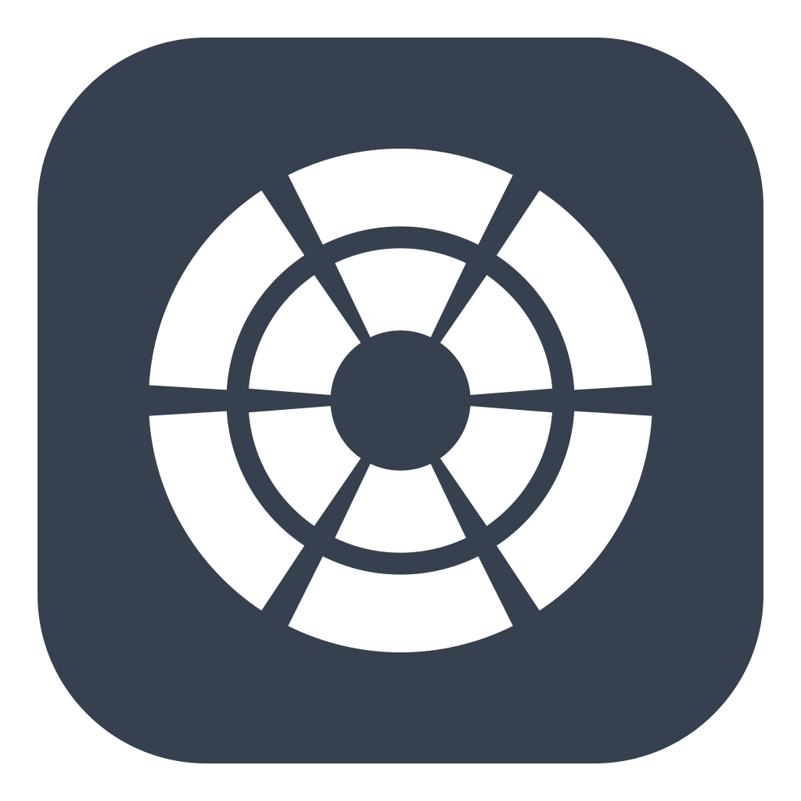

# NoteReach

Notation controls beside your pointer, for Dorico on macOS.

Choose note values, accidentals and articulations from a popup beside your work. Radial is the default layout for new users, with an optional Classic grid. Open it with Option–D, Option–right-click, or the configurable held-modifier gesture.

## Free beta

This repository distributes official NoteReach beta binaries and public documentation. The application source code is private and is not included here. Use of the official beta is free for personal or professional work under the accompanying NoteReach Beta License. Future releases may be paid products.

The beta requires macOS 14 or later and Dorico 6. It uses Dorico's local Remote Control connection and macOS Accessibility permission. No account is required. Work on a copy of a score while trying the beta.

Download the ZIP from the repository's [Releases page](https://github.com/mathewharwich/notereach-releases/releases), unzip it, and move NoteReach.app to Applications. Read the release notes for the actual supported architectures, tested systems and signing/notarization status of that exact build.

Choose the **NoteReach application ZIP** asset. GitHub's automatically generated “Source code” archives contain only this repository's documentation and artwork; they do not contain the app or its proprietary source code.

In Dorico, enable Preferences → Remote → Enable remote control. Open NoteReach's Settings, connect to Dorico and approve the connection. Enable NoteReach in macOS Privacy & Security → Accessibility, then check access again. If macOS requests Input Monitoring for your setup, approve that too.

## Support and privacy

- [Product information](https://dev.mathewharwich.com/notereach)
- [Support](https://dev.mathewharwich.com/notereach/support)
- [Privacy](https://dev.mathewharwich.com/notereach/privacy)
- [Beta terms](https://dev.mathewharwich.com/notereach/terms)
- [Report a reproducible bug](https://github.com/mathewharwich/notereach-releases/issues)

Report the macOS, Dorico and NoteReach versions and clear steps to reproduce a problem. Do not post private scores, credentials, personal macro libraries or unreviewed diagnostics. Ask for a private reporting route for sensitive reports.

The app connects locally to Dorico. It contains no analytics, cloud services or accounts. Its Dorico authorization credential is stored in macOS Keychain. Accessibility enables invocation gestures, context checks, selection observation and the dedicated Escape/Enter actions. Local diagnostics contain connection and menu state; review them before sharing.

NoteReach is an independent project by Mathew Harwich, not affiliated with or endorsed by Steinberg. Dorico is a Steinberg product. Bravura is distributed under the SIL Open Font License. See LICENSE and NOTICE for the applicable terms and attribution.
